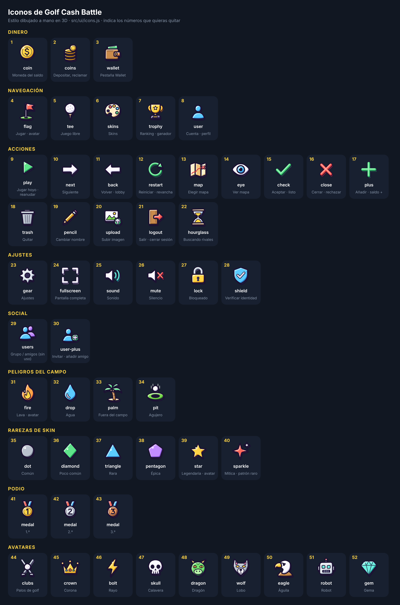

# Iconos

Todos los iconos del juego salen de [`src/ui/icons.js`](../../../../src/ui/icons.js), con un estilo común dibujado a mano en 3D: contorno de tinta con trazo de boceto, canto extruido en color, sombreado en dos tonos y brillo arriba a la izquierda.



La hoja está numerada para poder decidir cuáles se quitan. Se regenera con:

```sh
node scripts/icons-mockup.mjs
```

## Uso en código

- `icon('coin')` devuelve el `<svg>` en texto; acepta `{ tone, arg, size, cls, label }`.
- `tierIcon(tier)` para rarezas de skin y `avatarIcon(id)` para avatares.
- `iconUrl(name)` da una data URL para fondos CSS.
